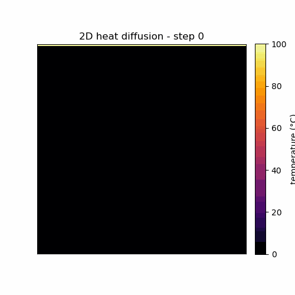
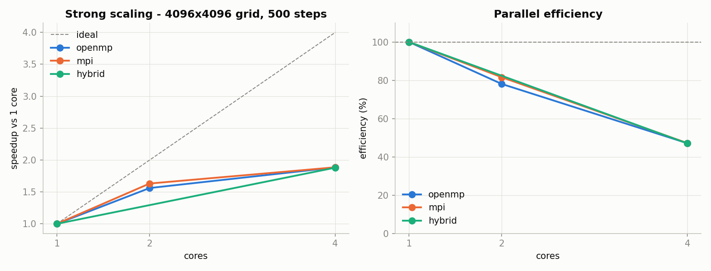
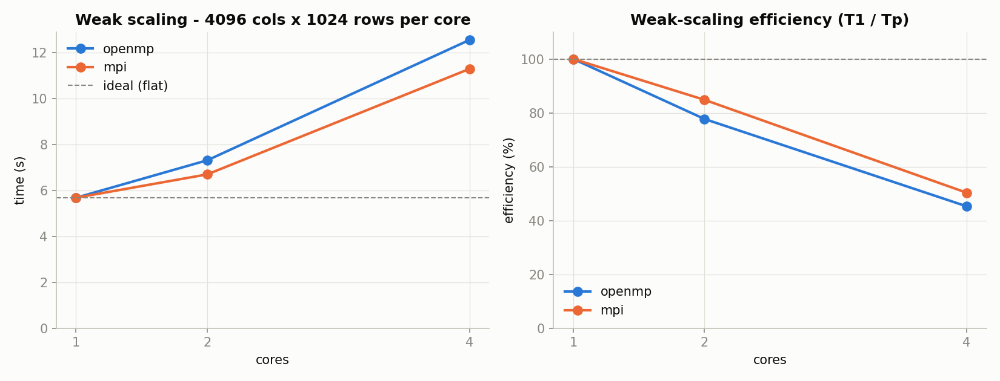
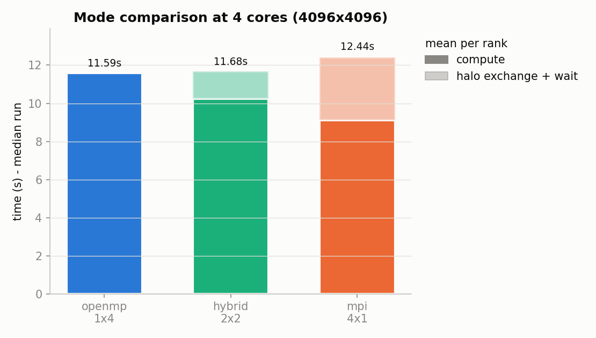
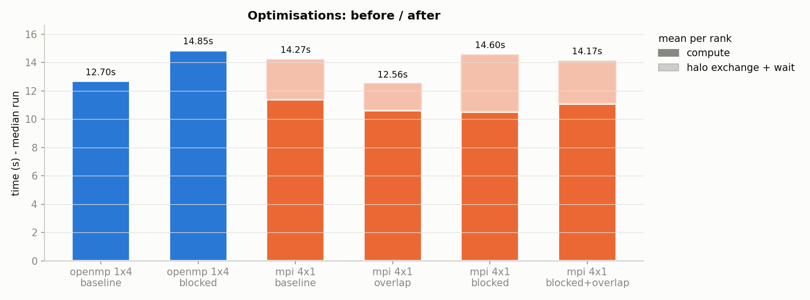

# heat2d: hybrid MPI + OpenMP 2D heat diffusion

A 2D heat-diffusion solver (5-point Jacobi stencil) in C++17. It uses row-wise
domain decomposition with MPI halo exchange between ranks and OpenMP threads
inside each rank. One binary runs serial, OpenMP-only, MPI-only or hybrid.
Every mode reproduces the serial reference **bit for bit**.

```
 global grid (ny x nx)          rank r's local array
 ┌──────────────────┐ ← 100°     row 0         top ghost    ◄── last row of rank r-1
 │ rank 0           │            rows 1..local owned rows   (threads split these)
 ├──────────────────┤            row local+1   bottom ghost ◄── first row of rank r+1
 │ rank 1           │
 ├──────────────────┤   before every step: halo exchange (2x MPI_Sendrecv)
 │ rank 2           │   then every rank updates its strip independently
 └──────────────────┘ ← 0° (left/right edges 0° too)
```

Rank 1 can't update its top row without rank 0's bottom row, and ranks don't
share memory. So each rank keeps one ghost row above and one below its strip.
Before each step, neighbouring ranks swap their edge rows into those ghosts.
Threads inside a rank share the strip's memory, so they never exchange messages.

## Build (Linux)

```bash
sudo apt install build-essential cmake openmpi-bin libopenmpi-dev linux-tools-common linux-tools-generic
sudo apt install python3-numpy python3-matplotlib python3-pandas
cmake -S . -B build -DCMAKE_BUILD_TYPE=Release
cmake --build build -j
cd build && ctest --output-on-failure        # 10 configurations, all must match serial exactly
```

On Windows or macOS, use the container: `docker build -t heat2d . && docker run --rm -it -v "$PWD:/work" heat2d`.
If a VM or container exposes its vCPUs as hyperthreads (Docker Desktop does),
use the following so every vCPU gets a rank or thread (this is how the
results below were produced):
`export CORES=4 OMP_PLACES=threads MPI_BIND=hwthread MPIRUN_EXTRA=--use-hwthread-cpus`
`perf` needs native Linux.

## Run

```bash
OMP_NUM_THREADS=8 ./build/heat 4096 1000                                   # OpenMP only
OMP_NUM_THREADS=1 mpirun -np 8 ./build/heat 4096 1000                      # MPI only
OMP_NUM_THREADS=4 mpirun -np 2 --map-by slot:PE=4 ./build/heat 4096 1000   # hybrid 2 ranks x 4 threads
```

`--map-by slot:PE=4` matters. By default OpenMPI pins each rank to one core, so
all 4 threads would share it. For thread pinning, set
`OMP_PROC_BIND=close OMP_PLACES=cores` (the scripts do this).

| option | meaning |
|---|---|
| `NX STEPS` | columns (and rows) and number of time steps |
| `--rows NY` | different row count (weak scaling) |
| `--alpha A` | diffusion coefficient, must be ≤ 0.25 (stability) |
| `--block B` | cache-blocked kernel, column tiles of B doubles |
| `--overlap` | non-blocking halo: compute the interior while ghost rows are in flight |
| `--verify` | gather on rank 0, rerun the serial reference, require max diff == 0 |
| `--snap K` / `--snap-dir D` | snapshot every K steps for the GIF (excluded from timing) |
| `--out FILE` | write the final grid (int32 ny, int32 nx, float64[]) |
| `--csv` | one CSV line, used by the benchmark scripts |

Output reports three times, measured with `MPI_Wtime` around the time loop
only, after one untimed warm-up exchange:
- **total:** the slowest rank, since that limits the run.
- **compute** and **halo:** the mean over ranks, so compute + halo ≤ total.
  Halo time includes waiting for a slower neighbour, so it measures
  synchronisation cost, not just message transfer.

It also prints throughput in MLUP/s (million lattice-cell updates per second)
and a checksum.

## Reproduce everything

```bash
scripts/run_all.sh            # build, ctest, strong/weak/modes/opt benchmarks, charts, GIF
QUICK=1 scripts/run_all.sh    # smaller grid, 3 reps: a 1-minute smoke run
scripts/verify.sh             # all modes on 513x513 must write byte-identical grids
scripts/perf.sh               # perf stat (IPC, cache misses) + perf record hot spots
python3 tests/model_check.py  # pure-Python model of the decomposition logic (no build needed)
```

| script | output |
|---|---|
| `run_strong.sh` | `results/strong.csv`: 4096², 1,2,4,…,cores; serial, OpenMP, MPI, hybrid |
| `run_weak.sh` | `results/weak.csv`: 4096 cols × 1024 rows per core |
| `run_modes.sh` | `results/modes.csv`: every ranks×threads split at full core count |
| `run_opt.sh` | `results/opt.csv`: baseline vs `--block`, `--overlap`, both |
| `plot.py` | `strong_scaling.png`, `weak_scaling.png`, `modes.png`, `opt.png`, `summary.md` |
| `make_gif.sh` | `results/heat.gif` |

The scripts use physical cores only (from `lscpu`, hyperthreads excluded). Each
configuration runs `REPS=5` times and the plots use the median. Overrides:
`NX`, `STEPS`, `CORES`, `REPS`, `BLOCK`, `MPIRUN_EXTRA`. For stable numbers,
keep the laptop plugged in with other apps closed.

## Results



**Machine:** Intel Core i5-1335U laptop, running in a Docker Desktop (WSL2)
VM with 4 vCPUs. The VM exposes them as **2 physical cores × 2 hyperthreads**,
so "4 cores" below means 2 real cores with hyperthreading. Ubuntu 24.04,
GCC 13, OpenMPI 4.1. Grid 4096², 500 steps, α = 0.25. Configurations are
interleaved, 5 runs each (7 for the optimisations), and every number is the
median run. Full tables: [results/summary.md](results/summary.md).

| | 1 core | 2 cores | 4 (2 + HT) |
|---|---|---|---|
| OpenMP time (s) | 20.9 | 13.4 | 11.1 |
| MPI time (s) | 20.9 | 12.8 | 11.1 |
| hybrid 2×2 time (s) | | | 11.1 |
| best speedup | 1.00× | 1.63× | 1.89× |
| throughput (MLUP/s) | 400 | 650 | 755 |






What the numbers show:

- **The kernel is memory-bandwidth bound.** Each cell update moves about
  24 bytes (read `u`, write `unew` plus the write-allocate) for 6 flops. At
  the best throughput of ~755 MLUP/s, that is about **18 GB/s** of DRAM
  traffic. A single core reaches only ~400 MLUP/s (~10 GB/s), because one core
  can't keep enough memory requests in flight. A second physical core gives
  1.6×. Adding hyperthreads gives only ~15% more, because hyperthreads share
  the same core and memory path.
- **All three modes converge at 4 cores** (OpenMP, MPI and hybrid all
  ≈ 11.1 s). When every configuration hits the same wall, the wall is the
  hardware, not the parallelisation scheme.
- **Weak scaling** rises from 5.7 s to 11.3 s as the work grows 4×. The memory
  traffic grew 4× but the available bandwidth only about 2×, so the rise is
  bandwidth, not communication. Halo messages are 2 rows × 32 KB per step,
  under 0.1% of the per-step traffic.
- **MPI's "halo" time (1–3 s) is waiting, not transfer.** Ranks sharing a
  physical core as hyperthread siblings run at different speeds, and the
  faster rank waits in `MPI_Sendrecv`. Each MPI rank's compute is faster than
  OpenMP's (9.1 s vs 11.6 s), but MPI loses that gain at the synchronisation
  points.
- **Cache blocking made it slower** (+17% for OpenMP, +2% for MPI). At
  nx = 4096, the 3-row working set (96 KB) already fits in L2, so tiling
  doesn't reduce DRAM traffic, and it breaks the long sequential streams the
  hardware prefetcher relies on. This is a measured negative result. The fix
  that would actually help here is temporal blocking.
- **Overlap** (`--overlap`) cut the MPI median by 12% (14.3 → 12.6 s) and
  the halo-plus-wait time by about a third. The run ranges still overlap on
  this noisy VM (11.3–17.9 s vs 11.8–15.8 s), so this is suggestive, not
  conclusive.
- `perf` profiling is not included: perf can't read hardware counters inside
  a Docker/WSL2 VM. Run `scripts/perf.sh` on native Linux to add IPC and
  cache-miss numbers.

## Correctness

- The stencil expression is written in the same operation order everywhere, and
  the code is compiled with `-ffp-contract=off` (no FMA fusion). So any
  decomposition gives bit-identical results to the serial reference, and the
  `--verify` check is max|diff| == 0, not a tolerance.
- CTest covers serial, OpenMP, MPI with 2–5 ranks (uneven splits, 1-row ranks,
  ranks owning only boundary rows), hybrid, blocked and overlap.
- `tests/model_check.py` mirrors the C++ logic in Python, with simulated ranks
  and poisoned (NaN) ghost cells. It checks that every interior cell is
  updated exactly once per step, that no unfilled ghost is ever read, and that
  results are bit-identical across an exhaustive sweep of small cases.

## Layout

```
heat2d/
├── CMakeLists.txt     build + ctest suite
├── Dockerfile         Ubuntu 24.04 + OpenMPI + Python toolchain
├── src/
│   ├── main.cpp       CLI, time loop, timers, gather, verify
│   ├── grid.hpp       decomposition + local strip with ghost rows (first-touch init)
│   ├── kernel.cpp     naive and cache-blocked stencil, serial reference
│   ├── halo.cpp       Sendrecv and Isend/Irecv halo exchange
│   └── io.cpp         grid / snapshot binary output
├── scripts/           run_*.sh, verify.sh, perf.sh, plot.py, animate.py
├── tests/             model_check.py
└── results/           CSVs, charts, GIF, summaries
```

## Stretch goals

- 2D block decomposition with `MPI_Cart_create`: halos on 4 sides, with less
  communication per rank at high rank counts.
- Temporal blocking (several time steps per sweep over a tile) is what actually
  beats the bandwidth limit.
- Run on a 32+ core cloud VM to extend the scaling curve.

## CV line

> Built a hybrid MPI + OpenMP 2D heat-diffusion solver in C++ (row-wise domain
> decomposition with halo exchange, bit-exact vs serial across all decompositions);
> benchmarked strong and weak scaling (1.9× on 2 cores + HT, ~18 GB/s effective
> bandwidth), showed the kernel is memory-bandwidth bound, and evaluated cache
> blocking (a measured slowdown, explained) and comm/compute overlap (−12% MPI time).

Rerun on a machine with more physical cores (and native Linux for perf) to
extend the curve, then update these numbers.
